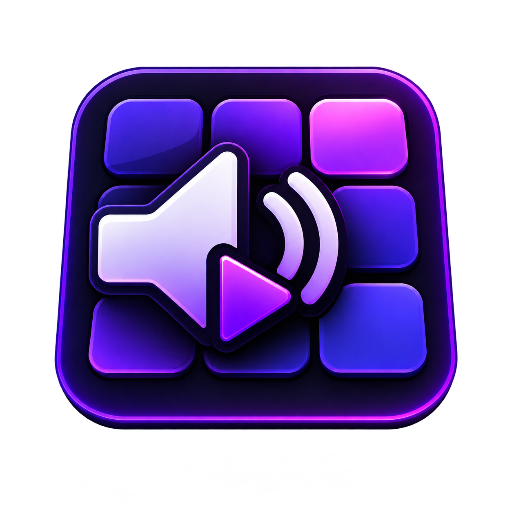

  

  <h1>BetterPad</h1>
  

  <h3>🚀 Version v0.3</h3>

  

    A powerful Soundpad alternative for Windows.
     
    Soundboard • Virtual Microphone • Audio Mixer • Hotkeys
  

 
  

    

  
  
  

    

  

    <b>Made with ❤️ for the audio community.</b>
  

  <h2>📢 Development Update</h2>

  <h3>BetterPad — Soundpad Alternative</h3>

  

    BetterPad is being developed as a full-featured alternative to
    <b>Soundpad</b>, with a modern interface and advanced audio features.
  

  

    ⚠️ <b>Development Notice</b>
  

  

    Developing BetterPad is a complex and resource-intensive process.
    Some features, especially the virtual microphone and audio engine,
    require significant development time and testing.
  

  

    Because of this, the official release date may be delayed.
    We cannot guarantee a specific release date at this time.
  

  

    Thank you for your patience, support and interest in BetterPad! ❤️
  

  
